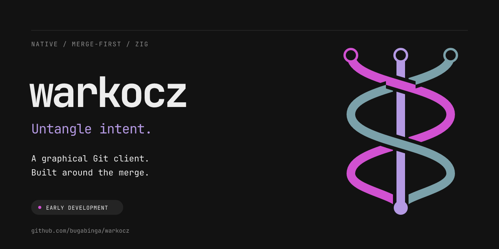

<picture>
  <source media="(prefers-color-scheme: dark)" srcset=".github/assets/banner-dark.png">
  <source media="(prefers-color-scheme: light)" srcset=".github/assets/banner-light.png">
  
</picture>

# warkocz

  

**Read changes clearly.
Resolve them deliberately.
Keep their meaning.**

[Specification](SPEC.html) · [Implementation evidence](IMPLEMENTATION.md) · [Contributing](CONTRIBUTING.md) · [Discussions](https://github.com/bugabinga/warkocz/discussions) · [Issues](https://github.com/bugabinga/warkocz/issues)

> [!IMPORTANT]
> **Early native GUI slice, not full product.**
> Launching `warkocz` without arguments opens native picker workflows: `D` opens read-only two-way inputs, `M` opens read-only three-way inputs, `R` selects a repository folder then an explicit installed Git executable, `K` restores an encrypted recovery draft to a new output path.
> Output uses a native Save picker and publication remains new-file-only: an existing destination is rejected, never replaced.
> `diff` and `merge` also open explicit local files in a native SDL window with a bounded diagnostic byte view, exact bounded multi-hunk source highlighting/navigation, whole-side choices, undo/redo, explicit resolve, asynchronous new-file Save, and asynchronous Complete verification gated by a matching durable receipt plus reread output/source identities.
> `repo --path PATH --git PATH [--history-limit COUNT]` opens installed-Git metadata/history inspection with selected-file history, literal history search and committed HEAD blame.
> Initial inspection and refresh never scan worktree status, so status is explicitly not scanned rather than clean.
> Review worktree status scan requires displayed preflight plus one explicit confirmation; configured clean/process filters may execute and grant expires after one scan attempt.
> Inspection uses native argv on bounded workers and grants no execution trust.
> Stage/Unstage/Commit, branch create/rename/safe-delete and configured Fetch/normal Push require separate exact-operation confirmation after fingerprinted preflight; hooks, filters, signing and remote access can execute under that grant.
> Fetch/Push preflight renders every collected sanitized endpoint row for its reviewed role: scheme/host-only where valid; userinfo, paths, queries and fragments remain hidden.
> Full effective configuration remains fingerprint-bound but is not disclosed.
> Endpoint-summary exhaustion fails visibly without a partial list; undersized remote-review windows cannot authorize execution.
> Git confirmation rejects key-repeat and Enter events predating the displayed review.
> Native GPU fixtures verify local transport callbacks remain untouched before confirmation, then verify authorized Fetch/normal Push effects against owned bare repositories.
> Real-network/credential acceptance remains incomplete.
> Inspection omits system/global config and requires Git's `--no-lazy-fetch` support.
> Worktree status remains not scanned until distinct one-use review/confirmation, while metadata/history/branches remain available; it never presents unscanned status as clean.
> Config inspection is observational, not race-safe isolation against concurrent hostile config changes.
> Save is Windows-local-NTFS-only, creates a destination that must not already exist, preserves supplied bytes, and rejects unsupported or remote filesystems before mutation.
> No replacement save, full advanced Git workflow, general structural parsing, editor-quality Unicode/grapheme input, final typography/accessibility, or cross-platform durable save exists.
> Result-only LSP uses an explicitly chosen and confirmed executable/workspace, synchronized unsaved text and URI/version-bound replies.
> Transport fixtures cover two independent unsaved documents; GUI remains single-result.
> Explicit detach and normal LSP exit teardown reuse the background job, retaining window/storage until teardown completes.
> Windows LSP uses owned Job Object teardown, cancellable pipe I/O and startup/request/shutdown deadlines; installed-Git execution shares one deadline across output collection and exit observation.
> Native non-Windows supervision and hard cleanup-latency guarantees remain incomplete.
> Diagnostics/hover and bounded symbols/definition/references target lists support current-result keyboard/mouse range navigation.
> External targets remain disabled pending a validated multi-file workspace view; real-server acceptance remains incomplete.
> Three-way sources explicitly named `.json` use bounded root-object JSON composition v1; malformed, duplicate-key, reordered/member-set, formatting, or budget cases remain exact unresolved byte review. Three-way sources explicitly named `.zig` use bounded Zig named top-level declaration merge v1; unsupported/malformed syntax or budget cases remain exact unresolved byte review, with whole-declaration provenance rather than word-diff claims.
> Windows establishes a protected random child under validated `%LOCALAPPDATA%` in a worker, then coalesces encrypted DPAPI draft snapshots on a 500 ms scheduling interval.
> This interval is not measured crash-loss or durability evidence.
> Setup/persistence failure is visible without blocking editing.
> Welcome provides bounded protected-draft discovery, explicit restore and confirmed Forget selected draft; manual Export remains distinct.
> Restoring revalidates originals in a worker and preserves unresolved/unreviewed status until deliberate resolution and new-file Save.
Result editing is provisional printable ASCII plus TAB, CR, and LF only: bytes remain exact, mouse drag and Shift-click select bounded byte ranges without splitting CRLF, selected ranges render visibly, keyboard edits/navigation scroll caret into view, and bounded edge drag autoscrolls.
Text-focused keys never invoke plain resolution/save actions; unsupported controls (including NUL, ESC, and DEL) or non-ASCII results remain visibly read-only byte review with whole-side choices.
> `SPEC.html` is binding completion contract.
> This slice does not satisfy it.

## Status

- [x] Native SDL window, bounded event routing, diagnostic byte rendering, action help/palette, explicit whole-side resolution, bounded undo/redo, scrolling, visible result selection, pointer drag/Shift-click selection, caret-following keyboard edits/navigation, provisional lossless-ASCII editing, clipboard actions, and Save invalidation.
- [x] Explicit new-file Save/Complete-verification worker with immutable job snapshots, stale generation/identity rejection, receipt digest validation, reread output/source verification, durable-completion gate, worker join on shutdown.
- [x] Windows NTFS new-file publication primitive with exclusive temporary handle, pre-rename cleanup safety, no-clobber rename, and post-rename flush failure recovery status.
- [x] Windows automatic DPAPI recovery journal: protected per-user random session directory, bounded two-slot snapshot worker, 500 ms scheduling interval rather than a measured loss bound, encrypted new-file records, owned-file retention, visible durability/failure state, plus manual export/restore.
- [x] Bounded core byte editing, multi-hunk exact line merge for ≤128-line three-way GUI sessions, visible lossless unresolved byte-review fallback when structural work is resource-limited or alignment is ambiguous, source change navigation/highlighting where available, in-memory resolution history, snapshot leases, lexical path checks, literal invocation parsing.
- [x] Shared stable action identities for native file/repository surfaces, explicit repository invocation, fixed-pool off-UI-thread metadata/history inspection, separately reviewed one-use worktree-status scans, and Fetch/Push endpoint review with owned sanitized evidence, visible backend/trust boundary, and failure UI.
- [x] Pinned SDL Zig wrapper plus SDL notices for current native GUI slice.
- [ ] Full SPEC implementation and acceptance evidence.

Windows 11 x64 is development host only.
Ubuntu Wayland/X11 and macOS ARM64 remain required product targets without native execution evidence.

Set absolute `WARKOCZ_FONT` when running the GUI to render product text through the vendored FreeType pipeline; without it the app falls back to SDL's ASCII debug font.

## Development

Requires [mise](https://mise.jdx.dev/) and Zig version pinned in [mise.toml](mise.toml).
Review configuration before trusting it or provisioning tools.

| mise task | Delegates to | Current purpose |
| :--- | :--- | :--- |
| `mise run build` | `zig build` | Builds native development executable. |
| `mise run run` | `zig build run` | Opens native picker launcher; terminal is not required for primary file/repository entry. |
| `mise run run -- diff <left> <right> <output>` | `zig build run -- …` | Legacy explicit two-way invocation. |
| `mise run run -- merge <base> <left> <right> <output>` | `zig build run -- …` | Legacy explicit three-way invocation. |
| `mise run test` | `zig build test` | Runs core, CLI, native non-GPU tests. |
| `mise run test-output-native` | `zig build test-output-native` | Opt-in Windows output fixture under `%LOCALAPPDATA%/Temp/warkocz-native-e2e`. |
| `mise run test-gpu` | `zig build test-gpu` | Opt-in SDL GPU GUI fixture, including async Complete verification. Set absolute `WARKOCZ_TEST_FONT` to also exercise the FreeType glyph pipeline proof. |
| `mise run test-recovery-native` | `zig build test-recovery-native` | Opt-in Windows DPAPI encrypted-recovery fixture under `%LOCALAPPDATA%/Temp/warkocz-native-e2e`. |
| `mise run test-git-native` | `zig build test-git-native` | Opt-in installed-Git inspection/mutation and local-bare-remote fixtures under `%LOCALAPPDATA%/Temp/warkocz-native-e2e`; requires absolute `WARKOCZ_TEST_GIT_EXE`. |
| `mise run test-git-process-native` | `zig build test-git-process-native` | Windows synthetic process deadlines, output pressure/limits and descendant cleanup; no repository required. |
| `mise run test-lsp-native` | `zig build test-lsp-native` | Synthetic LSP lifecycle, missing replies, backpressure and shutdown fixtures. |
| `mise run kb-check` | `zig build kb-check` | Applies the vendored kb build-time patches and syntax-checks the patched C header. |
| `mise run kb-patch-status` | `zig build kb-patch-status` | Reports which kb patches still match the pristine upstream pin; use when updating `third_party/kb`. |
| `mise run ft-check` | `zig build ft-check` | Compiles the vendored FreeType subset with the minimal vendored configuration. |
| `mise run fmt` | `zig build fmt` | Formats Zig sources. |
| `mise run check` | `zig build check` | Checks format plus test graph. |

`Save` never replaces an existing target.
`Complete` schedules worker rereads of output receipt bytes and source identities.
It succeeds only when that distinct current-session verification job matches current resolved generation and durable new-file receipt.
Output changes/deletion or source changes fail Complete without rewriting output.
Closing during Save or Complete verification joins worker and returns incomplete-resolution failure.

## Current limits

- Inputs and result: 192 KiB each.
- Structural comparison: ≤128 lines per side and 1,000,000 charged work units; larger/over-budget/ambiguous three-way inputs open as lossless unresolved byte review, never as an automatic clean merge.
- Presentation: ASCII diagnostic byte escapes, plus result-only lossless ASCII editing with byte-range pointer selection. This is not Unicode/grapheme editing, syntax rendering, IME support, or editor-quality text layout.
- Save: native picker or legacy explicit output path, Windows local NTFS, new file only.
- JSON: only three-way source paths explicitly ending `.json` select `json_root_object_merge v1`; it composes independent existing root-field value edits while preserving base bytes outside replacements. Malformed JSON, duplicate root keys, reordered/changed fields, formatting changes, scanner/member/key/work budgets, non-object roots, and all non-`.json` paths fall back visibly to unresolved exact byte review. Nested values are atomic; nested duplicate keys are not independently diagnosed, and competing nested edits conflict rather than compose.
- Zig: only three-way source paths explicitly ending `.zig` select `zig_declaration_merge v1`; bounded AST handling covers existing named top-level `fn`/`const`/`var` declarations with exact byte-range replacement. UI identifies whole-declaration scope and does not claim word-level structural diff. Malformed/unsupported syntax, declaration-set/order changes, ambiguous surrounding bytes, and resource limits remain unresolved exact byte review. This narrow fixture-backed slice is not Mergiraf-comparable full structural merge.
- Recovery: Windows automatic journal creates a verified protected random child directly under `%LOCALAPPDATA%`, encrypts DPAPI records off UI, coalesces edits on a 500 ms scheduling interval, retains only bounded owned records, and visibly reports protection state.
Setup failure leaves editing usable but explicitly unprotected.
Welcome supports bounded prior-draft discovery, explicit Restore and confirmed Forget; exact restoration has native GPU coverage.
Forced-close/crash-matrix acceptance and measured ≤1-second loss guarantees remain incomplete.
DPAPI encryption is unsupported outside Windows.
- Git: metadata inspection remains untrusted and never scans worktree status; status scans and supported mutations require exact-operation preflight and explicit one-use grant.
Fetch/Push review shows bounded sanitized configured endpoint identities, never raw URLs; endpoint paths and credentials remain hidden while full effective configuration stays fingerprint-bound.
Configured hooks/filters/signing and remote operations are trusted execution, not a sandbox.
Windows subprocess timeout terminates owned processes but leaves mutation outcome unknown; refresh/reconcile rather than assuming rollback or automatically retrying.
- Dependency stack: SDL only.
- Launcher: native SDL dialogs, keyboard/mouse/palette entry, bounded copied callback paths, and worker-based initial loading, hashing and session construction.
Picker cancellation retains welcome; pending picker dismissal is required before close.
Injected event tests do not establish real OS-picker or accessibility acceptance.

`THIRD_PARTY.md` records current SDL wrapper and SDL notices.
Typography, editor, structural parsing, Git, LSP, fonts, and accessibility candidates are not adopted dependencies.

## Repository map

| Path | Responsibility |
| :--- | :--- |
| [SPEC.html](SPEC.html) | Binding completion contract. |
| [IMPLEMENTATION.md](IMPLEMENTATION.md) | Evidence, gaps, approval state. |
| [src/ui/native.zig](src/ui/native.zig) | Provisional native SDL diagnostic UI. |
| [src/save.zig](src/save.zig) | Bounded asynchronous new-file publication controller. |
| [src/output.zig](src/output.zig) | Windows NTFS publication primitive. |
| [src/session.zig](src/session.zig) | In-memory resolution state plus optional bounded multi-hunk merge provenance. |
| [src/vcs/inspect.zig](src/vcs/inspect.zig) | Installed-Git read-only bounded metadata/history inspection; worktree status needs separate reviewed execution. |
| [src/ui/repository.zig](src/ui/repository.zig) | Native fixed-pool off-UI-thread repository inspection view. |
| [src/ui/actions.zig](src/ui/actions.zig) | Shared stable native action identities. |
| [THIRD_PARTY.md](THIRD_PARTY.md) | Current third-party notices. |

## License

Project-owned code and artwork: [MIT](LICENSE).
Third-party terms appear in [THIRD_PARTY.md](THIRD_PARTY.md).
